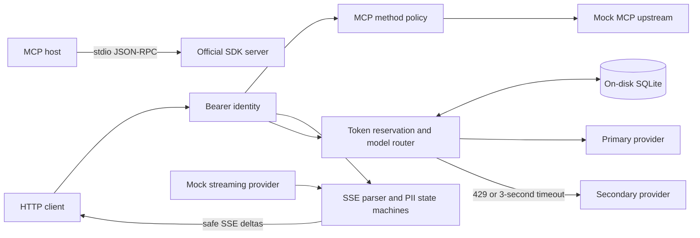

# Gateway Lab

**Four QuilrAI assessment tasks. One rule: enforce the boundary before crossing it.**

An official-SDK MCP server, an authenticated MCP proxy, a streaming PII guardrail, and a persistent token router. Every provider is mocked locally, so the entire submission runs without a model account or a bill.

Built by **Shiva Reddy** for the AI Solutions Engineer assessment.

## Start here

Requires Python 3.11+ and [uv](https://docs.astral.sh/uv/getting-started/installation/).

```bash
uv sync --locked
uv run --locked quilr-demo
```

The demo starts two loopback servers on available ports, launches the MCP stdio server through the official client, exercises all four tasks, prints observed timing, and removes its temporary database and child processes. Allow about five seconds after dependencies are installed. A failed assertion exits nonzero.

```bash
make check
make test
```

No `make` installed? Run the three commands directly:

```bash
uv run --locked ruff check src tests
uv run --locked ruff format --check src tests
uv run --locked pytest --cov=quilr_gateway --cov-report=term-missing --cov-fail-under=94
```

The lockfile includes every resolved dependency and package hash. The official MCP SDK is deliberately pinned to `1.26.0`, whose low-level session API is exercised by the integration tests. This is not an untested migration to whichever SDK happens to be newest.

## What to review

| Assessment | Implementation | Proof worth opening |
| :--- | :--- | :--- |
| 1. Strict MCP server over stdio | [mcp_server.py](src/quilr_gateway/mcp_server.py), [stdio_boundary.py](src/quilr_gateway/stdio_boundary.py) | Official-client handshake, schema discovery, raw stdout inspection, standard error codes |
| 2. Bearer-authenticated MCP proxy | [app.py](src/quilr_gateway/app.py), [config.py](src/quilr_gateway/config.py) | A denied `admin_` call causes zero upstream invocations; `tools/list` result passes through unchanged |
| 3. Chunk-safe streaming PII masking | [guardrail.py](src/quilr_gateway/guardrail.py) | Every split inside representative PII, one-byte SSE chunks, Unicode splits, malformed/truncated streams, disconnect cleanup |
| 4. SQLite token quota and fallback | [limiter.py](src/quilr_gateway/limiter.py), [router.py](src/quilr_gateway/router.py) | Concurrent processes, exact expiry, restart persistence, cancellation, trickling bodies, honest usage accounting |

The [assessment document](https://docs.google.com/document/d/1oZcsFEOcbCmQj_zflQbQYjIWOg-oS3XW/edit) was checked through its text export on November 5, 2026. All four numbered tasks are covered. Its overview mentions zero-trust troubleshooting but does not define a fifth task; deployment considerations are included in the [security notes](docs/security.md).

## Architecture at a glance



The HTTP MCP component implements the assessment's bounded JSON-RPC proxy contract. It is not advertised as a complete Streamable HTTP MCP transport. Task 1 supplies the full SDK-managed MCP initialization and stdio lifecycle.

## Run the services yourself

Terminal 1, mock upstreams:

```bash
uv run --locked uvicorn quilr_gateway.mocks:app --host 127.0.0.1 --port 9001 --no-access-log
```

Terminal 2, gateway with explicit demo credentials:

```bash
QUILR_DEMO=1 uv run --locked uvicorn quilr_gateway.app:create_app --factory \
  --host 127.0.0.1 --port 8000 --no-access-log
```

The default SQLite file is `var/quota.sqlite3`. It survives restarts and is excluded from Git. Demo credentials are synthetic and public by design:

| Bearer token | Role | Tenant |
| :--- | :--- | :--- |
| `demo-viewer-token` | viewer | tenant-a |
| `demo-admin-token` | admin | tenant-a |
| `demo-other-tenant-token` | viewer | tenant-b |

For your own identities, supply `QUILR_TOKENS_JSON` instead:

```bash
export QUILR_TOKENS_JSON='{"replace-with-random-secret":{"role":"viewer","tenant":"team-a"}}'
```

The gateway refuses to start without a token map or explicit demo mode. Two keys can map to one tenant and share quota. A client cannot select its tenant, role, or upstream URL in a request.

### Task 1: MCP stdio server

Configure an MCP host to launch `uv run --locked quilr-mcp` with this repository as its working directory. For a host that expects an executable path, use the absolute path to `.venv/bin/quilr-mcp` after `uv sync --locked`.

Tools:

```json
{"name":"get_customer_record","arguments":{"customer_id":"CUST-00001"}}
```

```json
{"name":"trigger_refund","arguments":{"customer_id":"CUST-00001","amount":12.50,"reason":"Duplicate purchase"}}
```

`CUST-` must be followed by exactly five ASCII digits. Unknown fields, coercible strings, booleans as amounts, nonfinite numbers, and padding-only reasons are rejected. Positive JSON integers are accepted as numbers. Refunds are simulations; no payment processor is connected.

Malformed JSON returns `-32700`, malformed envelopes `-32600`, unknown methods `-32601`, and invalid tool arguments `-32602`. IDs are preserved. Valid notifications never receive replies. All diagnostic logs use stderr; stdout contains only JSON-RPC.

### Task 2: authorization before forwarding

```bash
curl -sS http://127.0.0.1:8000/mcp \
  -H 'Authorization: Bearer demo-viewer-token' -H 'Content-Type: application/json' \
  -d '{"jsonrpc":"2.0","id":7,"method":"tools/call","params":{"name":"admin_reset_key","arguments":{}}}'
```

```json
{"jsonrpc":"2.0","id":7,"error":{"code":-32001,"message":"Unauthorized Tool Call"}}
```

Switch the token to `demo-admin-token` and the mock executes the tool. `tools/list` is deliberately not filtered, as requested. The `admin_` prefix is case-sensitive. The fastest unauthorized call is the one that never leaves the gateway.

### Task 3: a live, redacted stream

```bash
curl -N http://127.0.0.1:8000/v1/stream \
  -H 'Authorization: Bearer demo-viewer-token' -H 'Content-Type: application/json' \
  -d '{"prompt":"Show the synthetic PII example","max_tokens":128}'
```

Concatenated content is:

```text
Ready. Email [REDACTED]; SSN [REDACTED]; card [REDACTED]. Café done.
```

The provider intentionally splits both sensitive strings and UTF-8 bytes. The guardrail emits safe words at delimiters, holding only the unresolved candidate. It retains at most 318 candidate characters across two stages, plus one SSE event capped at 16,384 characters. The response is never accumulated in full.

Policy is deliberately conservative: ASCII email-like atoms containing `@`, nine-digit numeric candidates, SSN shapes, and numeric runs with at least 13 digits are masked. Long atoms are masked and drained once they exceed their cap. This protects against long-prefix evasion but can mask long harmless identifiers and numeric sequences. [The exact policy and limits](docs/security.md#streaming-policy) are part of the contract.

The output is normalized single-choice text SSE, ending in `data: [DONE]`. Metadata and unsupported tool-call deltas are not forwarded. A broken stream produces a sanitized `event: error`, never a misleading success marker or an unresolved PII suffix.

### Task 4: quota and fallback

```bash
curl -sS http://127.0.0.1:8000/v1/completions \
  -H 'Authorization: Bearer demo-viewer-token' -H 'Content-Type: application/json' \
  -d '{"prompt":"[timeout] Try the backup","max_tokens":128}'
```

Use `[429]` instead to exercise immediate fallback, ordinary text for primary success, or `[error]` for a sanitized provider failure. The brackets are mock scenario controls, not production request-routing controls.

Each attempt reserves an upper bound before dispatch. Successful attempts reconcile to validated provider usage. Explicit 429s release their reservation. Timeouts keep their full charge because the provider may have generated tokens before the connection closed. The backup must obtain its own reservation.

**A timeout is not a receipt for zero tokens.**

The default limit is 50,000 tokens per tenant over a trailing 60-second completion window, including pending reservations. Reservations use `BEGIN IMMEDIATE`, so separate workers cannot both spend the same remaining quota. SQLite work runs off the event loop. A crashed request retains a conservative 90-second lease. See [accounting details](docs/architecture.md#quota-accounting) for the exact rules.

Both provider headers and response body sit inside the same three-second attempt deadline. A trickle of bytes cannot keep the primary alive indefinitely. Only 429 and timeout trigger fallback; secondary failure ends the chain. No detached primary task continues locally after fallback begins. Cancellation of the local request does not prove that remote generation stopped.

## Observability

Every HTTP response includes a generated `X-Request-ID`. Application logs are JSON on stderr and contain fixed event names, status, timings, request IDs, and redaction counts. They contain no tokens, prompts, tool arguments, or raw exception strings.

```bash
curl -sS http://127.0.0.1:8000/metrics -H 'Authorization: Bearer demo-admin-token'
```

Prometheus-format counters include denied MCP calls, provider attempts, 429s, timeouts, fallbacks, stream failures, quota denials, and redactions. Counters are per process and reset on restart; quota state does not. First-safe-content timing measures gateway-visible content, not provider-internal token generation.

## Verification and handoff

The current execution record is in [docs/verification.md](docs/verification.md). Tests include generated chunk partitions with Hypothesis and a real subprocess/network demo. CI runs lint, formatting, coverage-gated tests, and the demo on Python 3.11, 3.12, and 3.13. A configured workflow is not evidence that GitHub has run it yet.

- [Architecture and accounting](docs/architecture.md)
- [Security boundaries and deliberate trade-offs](docs/security.md)
- [Reviewer walkthrough and operating notes](docs/reviewer-guide.md)
- [Publish and submit](docs/submission.md)

The gateway intentionally exposes separate streaming and non-streaming routes. PII masking applies to `/v1/stream`; `/v1/completions` demonstrates quota and routing and returns provider text without that guardrail. Real provider adapters, OAuth/JWT verification, distributed quota storage, refund idempotency, and production ingress are documented next steps, not claimed features.

MIT licensed. No real customer or payment data is included.
