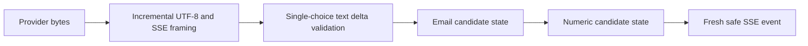

# Architecture and invariants

The package keeps policy close to the decision it controls. The stdio server owns tool schemas. The HTTP boundary owns identity and method authorization. The stream transformer owns every emitted text byte. The router owns every provider attempt and its quota reservation.

## MCP lifecycle and error mapping

Task 1 uses the official `mcp` package's `Server`, `stdio_server`, request models, initialization options, and client session. It exposes exactly two tools. Pydantic models generate their published JSON Schemas and validate their arguments with strict types and forbidden extra fields.

Two SDK details are handled explicitly:

1. The pinned SDK's `call_tool` convenience decorator catches exceptions and returns `isError` tool results. The assessment requests JSON-RPC validation errors. Registering the handler through `server.request_handlers[CallToolRequest]` lets `McpError(-32602)` reach the SDK's protocol response path.
2. The default transport logs malformed lines. `StrictInput` performs JSON and request-model preflight and emits standard parse/request/params errors through a shared serialized writer. Valid input continues through the official transport and session. No SDK source is patched.

This small version-specific integration is why the SDK is pinned and tested at the wire level. A future upgrade must pass these tests before its pin changes. This server never issues server-to-client requests, so the stdio preflight accepts client requests and notifications, not response envelopes.

The HTTP proxy accepts one MCP-style JSON-RPC object per POST. Arrays/batches and null/boolean IDs are rejected. MCP string and integer IDs, including zero, are preserved. Supported methods are initialization, initialized notification, ping, tool listing, and tool invocation. Other methods receive `-32601`.

`tools/list` is forwarded and its result is preserved. `tools/call` authorization examines the exact, case-sensitive name that is forwarded. There is no URL decoding, trimming, or case folding that could create a policy/dispatch mismatch. The caller's bearer credential never crosses to the mock upstream. Notifications are policy-checked but receive an empty HTTP 202 instead of a JSON-RPC reply.

## Streaming pipeline



Transport chunks are not tokens, JSON records, or PII boundaries. The parser understands split UTF-8, CR/LF/CRLF, comments, and multiline data. Provider metadata is never copied into output events. An invalid envelope terminates the stream through a sanitized error event.

An ASCII email candidate is held until a delimiter. A candidate containing `@` is masked as a whole; this deliberately includes malformed addresses. Email output then passes through a numeric stage, which can hold digits across spaces and hyphens. This ordering catches a card split across both text deltas and word boundaries.

The email stage holds at most 254 characters, the numeric stage at most 64. Overflow emits one mask and enters a drain state until the candidate ends. Safe delimiters pass through immediately. Each character is examined a constant number of times; numeric matching is limited to a 64-character candidate, with no regex scan over an ever-growing response.

SSE events are capped at 16,384 decoded characters, and transport chunks are processed in 1,024-byte parser slices. There is one bounded event buffer plus the 318-character candidate budget, not a full-response buffer. HTTP library transport buffers are outside that retained-state figure.

The terminal `[DONE]` marker makes it safe to flush the final candidate. EOF without that marker does not. `StreamingResponse` drives the async generator with backpressure. A client disconnect cancels iteration, exits the upstream response context, and closes the provider stream. Tests exercise that ASGI disconnect path directly.

## Quota accounting

For plain-text completion input, admission reserves:

```text
reserved_tokens = UTF-8 byte length(prompt) + max_tokens
```

This is a conservative prompt-token upper bound for a provider using a byte-based tokenizer with no hidden prompt additions. The mock adapter follows that contract. An adapter adding system prompts, chat templates, images, or provider-specific special tokens must include their cost or use that provider's tokenizer. An estimate such as `characters / 4` is not an enforcement boundary.

The ledger stores reservation ID, hashed tenant identifier, token count, expiry, and pending/settled state. It stores no API keys, prompts, or completions. `BEGIN IMMEDIATE` serializes admission across connections and processes sharing the same local database file:

1. Read a nondecreasing persisted wall-clock value.
2. Remove expired records with `expires <= now`.
3. Sum the tenant's live settled charges and pending reservations.
4. Reject if the new reservation would exceed 50,000; otherwise insert it atomically.

The admission inequality is `live_tokens + requested_tokens <= limit`. Reconciliation is a one-way transition guarded by `pending=1`, so repeated cleanup cannot credit a reservation twice.

Every database operation explicitly closes its connection after committing or rolling back. Python's SQLite connection context manager only handles the transaction; `contextlib.closing` owns the handle lifetime. No connection remains stored in the limiter or available for a later fork to inherit. Tests retain tracked connections to verify closure on success and failure, and exercise quota contention with fork, spawn, and forkserver where available.

| Attempt result | Charge | Next step |
| :--- | :--- | :--- |
| Valid success | Validated actual total | Return selected provider |
| Explicit 429 | Zero | Reserve and try secondary, if primary |
| Timeout | Full reservation | Reserve and try secondary, if primary |
| Transport error, other HTTP error, malformed body/usage | Full reservation | Sanitized failure |
| Caller cancellation | Full reservation | No fallback |
| Process crash or cleanup interrupted | Full pending lease | Expires after 90 seconds |

Settled charges remain for 60 seconds after completion. Pending requests count immediately and have a 90-second crash lease. This is deliberately more conservative than an arrival-time-only window and avoids freeing quota while an active request is using it. Completion-time expiry also prevents a request from waiting out the window during generation. The primary and secondary are separate attempts for accounting purposes.

Usage is accepted only if counts are strict nonnegative integers, sum correctly, stay within the reserved prompt-byte bound, and respect the requested output maximum. It is trusted provider accounting, not independently measured billing. A dishonest provider can underreport; this demo cannot prove its tokenization remotely.

The persisted clock clamps backward jumps. Forward wall-clock jumps can expire entries early relative to elapsed real time, an operational limitation of a persistent wall-clock window. SQLite is for one host with a local durable volume, not independent replicas or a network filesystem. Database contention has a 250ms bound and fails closed as HTTP 503.

`Retry-After` is an earliest-expiry hint. A large request may still need more quota after that time. Zero-token settlements are evicted with other expired rows on later admission. Idle databases do not run a cleanup daemon.

## Provider deadlines and errors

Each attempt has one `asyncio.timeout(3.0)` scope around response headers and the bounded body read. Per-read timeouts alone would allow a slow trickle to extend the attempt indefinitely. On timeout, local cancellation and response cleanup finish before fallback begins. There is no background task or speculative second request.

Only 429 and timeout trigger fallback, exactly as specified. A secondary 429 or timeout ends the chain. Non-429 errors do not silently amplify load. Total provider time is bounded at about six seconds across two attempts, plus quota transaction/cleanup and scheduling overhead; it is not a six-second end-to-end SLA.

Errors return a stable `{ "error": { "code", "message", "request_id" } }` shape. Quota denial is 429, exhausted providers 503, upstream faults 502, and malformed client input 400/413/415. MCP protocol errors retain their JSON-RPC envelope. HTTP auth errors use 401 and `WWW-Authenticate: Bearer`. After SSE headers are sent, streaming failures use `event: error` because the HTTP status can no longer change.
